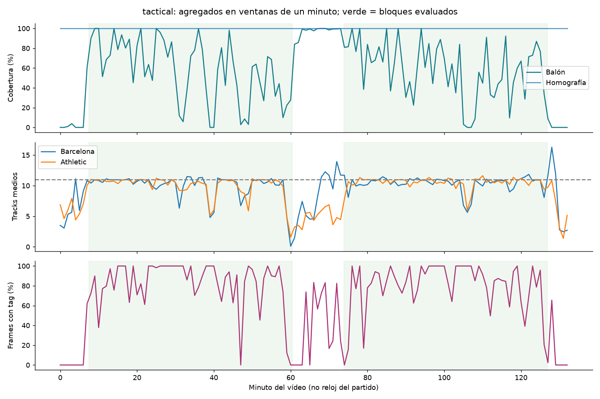
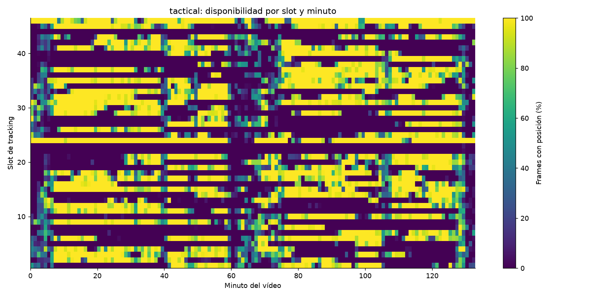
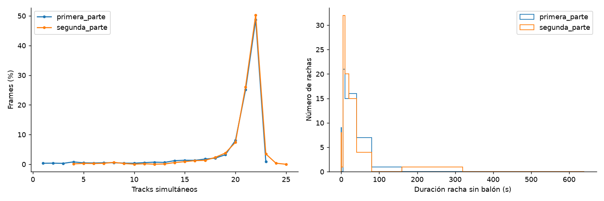
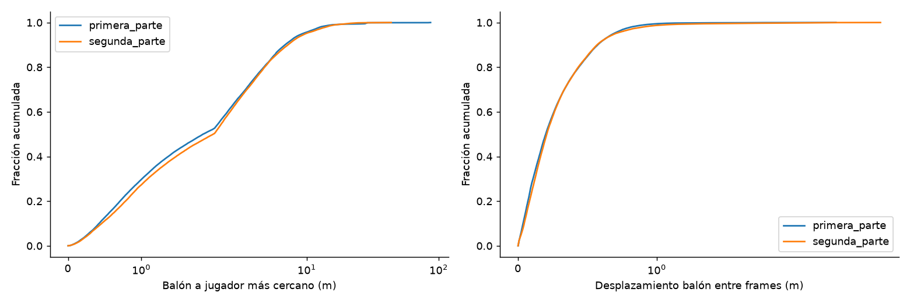
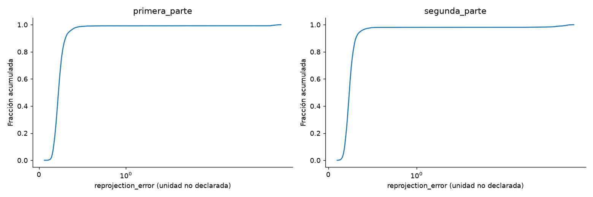
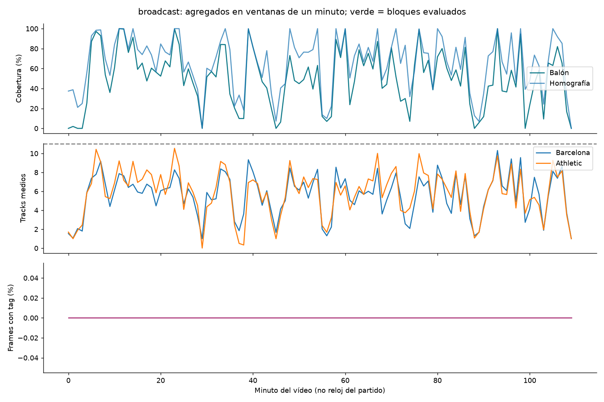
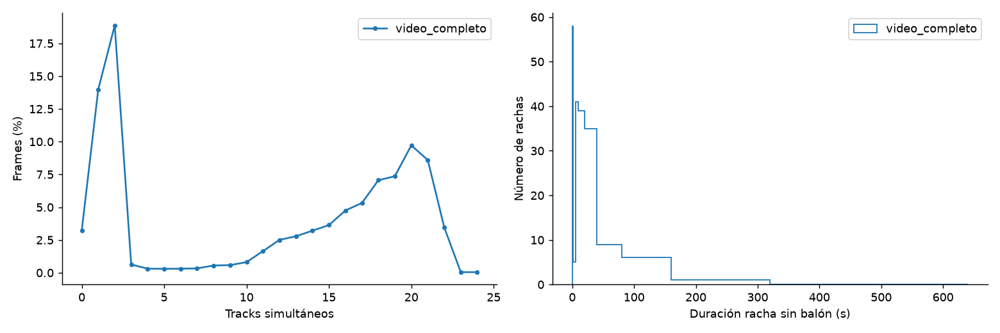
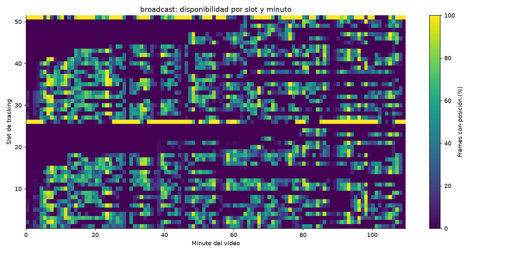
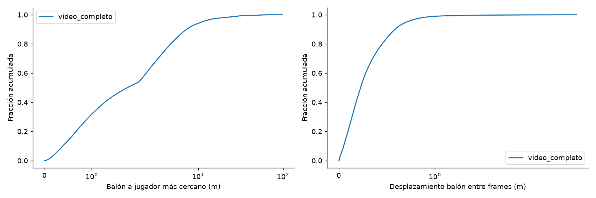
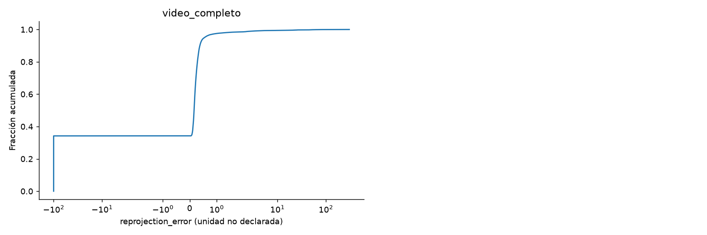

# EDA de los datos iniciales — More Than A Hack 2027

Fecha: 2026-11-01. Partido: FC Barcelona–Athletic Club. Análisis local de los archivos entregados, sin modificar datos originales.

## 1. Conclusiones principales

Los datos permiten construir un baseline de posesión, pero no constituyen una observación completa y corregida del partido. La posición del balón está disponible en el 59,31 % de los frames de los bloques oficiales. Balón + exactamente 11 tracks por equipo + homografía coexisten en el 31,00 %. La homografía táctica existe en todos los frames, pero eso no certifica su precisión. No se entregan cajas de detección ni identidad real estable.

Las prioridades técnicas son manejar ausencias prolongadas del balón, evaluar la coherencia geométrica y temporal y utilizar eventos como evidencias. Reentrenar o sustituir detectores es una opción que este EDA ayuda a dirigir, no una mejora demostrada por estos recuentos. No se ha medido F1 ni elegido parámetros contra etiquetas públicas.

Hallazgos adicionales respecto a la auditoría de cobertura:

- **Unidad de velocidad:** en 40.432 y 40.699 muestras de las partes, la mediana s/(desplazamiento en m/s) es 1,0008 y 1,0004. Favorece claramente m/s frente a kph, aunque el proveedor no lo ha confirmado.
- **Huecos largos:** casi todos los frames sin balón pertenecen a rachas de al menos cinco segundos (aproximadamente 99,9 % y 99,5 % de los frames ausentes, respectivamente). Una interpolación de huecos breves no resolverá la mayor parte de la ausencia.
- **Tiempo sin partido:** dentro del bloque oficial de descanso hay posición de balón en el 94,07 % de frames y Smart Tagging en el 38,48 %. Son señales automáticas, no prueba de juego activo; conviene respetar los bloques oficiales y revisar la coherencia temporal antes de inferir estados.
- **Broadcast:** el vídeo contiene un frame declarado menos que sus tablas; el índice de la última fila ATD no se pudo decodificar. No queda demostrado dónde se origina la discrepancia.
- **Saltos de jugadores:** 77 y 223 pares consecutivos superan 1 m por frame (equivalente a más de 25 m/s aparentes). Son candidatos a error/identidad cambiante, no correcciones ya realizadas.

## 2. Alcance, trazabilidad y método

Unidad de observación principal: frame de vídeo. En jugadores, una observación es (frame, slot); en eventos, un intervalo. Se analizan completos ambos ATD y ambas homografías; Smart Tagging solo existe para táctica. Vídeos: lectura de cabecera y decodificación de cinco fotogramas espaciados por vídeo, sin decodificación exhaustiva ni anotación visual.

Posición disponible = x e y finitos; velocidad disponible = s finita además de posición. No se interpolan huecos, se suavizan trayectorias ni se recortan coordenadas. Distancias: escala 105,3 × 68,0 m de games.py; el XML declara 105 × 68 m (diferencia longitudinal de 0,286 %). Desplazamientos: solo pares consecutivos observados, sin cruzar huecos ni límites de parte.

Inventario con tamaños físicos; input_sha256.csv identifica exactamente las entradas no audiovisuales. Los vídeos se identifican por nombre, tamaño y propiedades de cabecera; no se calculó su hash completo. Esta edición comparte el informe y gráficos estadísticos agregados; los archivos originales y los resultados detallados generados permanecen fuera de Git. No se han consultado ficheros de ground truth, servicios externos ni datos humanos adicionales del partido.

| file | bytes | MiB |
|---|---|---|
| broadcast\BAR-ATH_broadcast.mp4 | 13.962.360.320 | 13.315,544 |
| broadcast\BAR-ATH_broadcast_atd.txt | 141.966.465 | 135,390 |
| broadcast\BAR-ATH_broadcast_atd.xml | 64.956 | 0,062 |
| broadcast\BAR-ATH_broadcast_homography.csv | 15.401.635 | 14,688 |
| README.md | 2.161 | 0,002 |
| tactical\BAR-ATH_tactical.mp4 | 5.222.307.334 | 4.980,380 |
| tactical\BAR-ATH_tactical_atd.txt | 195.714.285 | 186,648 |
| tactical\BAR-ATH_tactical_atd.xml | 59.057 | 0,056 |
| tactical\BAR-ATH_tactical_homography.csv | 23.187.043 | 22,113 |
| tactical\BAR-ATH_tactical_smart_tagging.xml | 261.055 | 0,249 |

Entorno ejecutado:

| python | numpy | pandas | matplotlib | opencv-python-headless |
|---|---|---|---|---|
| 3.12.14 | 2.5.4 | 3.1.0 | 3.11.2 | 5.0.0.93 |

## 3. Vídeos y alineación temporal

| fuente | frames_header | frames_atd | fps_header | width | height | duration_seconds_header |
|---|---|---|---|---|---|---|
| tactical | 199.319 | 199.319 | 25,000 | 1.920 | 1.080 | 7.972,760 |
| broadcast | 164.487 | 164.488 | 25,000 | 1.920 | 1.080 | 6.579,480 |

| fuente | sample_decodes | samples_requested | atd_minus_video_frames | last_atd_index_decodes |
|---|---|---|---|---|
| tactical | 5 | 5 | 0 | 1 |
| broadcast | 5 | 5 | 1 | 0 |

La táctica coincide en cabecera, ATD y homografía (199.319 filas/frames). Broadcast presenta una discrepancia: vídeo con 164.487 frames declarados frente a 164.488 filas ATD y homografías. La tabla incluye el intento de decodificar el índice de la última fila ATD; esta prueba de extremo no determina si el desfase está solo al final o en otro punto. No se elimina una fila ni se aplica un offset arbitrario. La muestra decodificada no prueba la integridad de todos los fotogramas. La retransmisión tiene cortes/repeticiones y NO está sincronizada frame a frame con la táctica; no se trasplantan sus límites de partes.

| periodo | first_frame | last_frame | frames | duration_s |
|---|---|---|---|---|
| video_completo | 0 | 199.318 | 199.319 | 7.972,760 |
| primera_parte | 11.185 | 90.651 | 79.467 | 3.178,680 |
| segunda_parte | 110.808 | 190.197 | 79.390 | 3.175,600 |
| antes | 0 | 11.184 | 11.185 | 447,400 |
| descanso | 90.652 | 110.807 | 20.156 | 806,240 |
| despues | 190.198 | 199.318 | 9.121 | 364,840 |

| periodo | balon_pct | tracks_medios | H_valida_pct | tags_pct |
|---|---|---|---|---|
| video_completo | 56,938 | 18,977 | 100,000 | 70,032 |
| primera_parte | 59,349 | 20,121 | 100,000 | 83,650 |
| segunda_parte | 59,266 | 20,854 | 100,000 | 80,897 |
| antes | 1,574 | 12,792 | 100,000 | 1,037 |
| descanso | 94,071 | 12,514 | 100,000 | 38,480 |
| despues | 1,502 | 14,531 | 100,000 | 11,150 |

Los bloques de primera/segunda parte proceden de half_video_blocks en games.py, incluyen interrupciones y no son dos ventanas de 45 minutos. La segunda ventana oficial comienza antes del saque inicial de esa parte: no debe confundirse inicio del bloque evaluado con instante de reanudación. Los parámetros de partes del XML ATD son genéricos (primera abarca el vídeo y segunda vacía); no deben sustituir a los límites oficiales.

Claves: ATD frame_id desde 1 → video_frame = frame_id − 1; homografía frame desde 0; eventos en segundos desde el inicio del vídeo táctico → round(segundos × 25). Los offsets grandes de games.py pertenecen al contador de origen del ground truth y no se suman al ATD entregado.

## 4. Diccionario de datos y esquema

ATD TXT: `frame_id:slot_1;slot_2;…;slot_k:ball`, cada grupo `x,y,s`. Coordenadas x,y normalizadas del campo, no píxeles. El XML aporta equipo y atributos por slot. Matrices CSV: frame, h00…h22, reprojection_error, valid. La homografía transforma campo normalizado → píxeles; la dirección inversa requiere invertirla y dividir por la coordenada homogénea.

| fuente | slots | Barcelona | Athletic | unidad_s_XML |
|---|---|---|---|---|
| tactical | 46 | 24 | 22 | kph |
| broadcast | 51 | 26 | 25 | kph |

Hay dos slots portero en cada fuente; los demás tienen position_type Unknown. En táctica son 24 y 46. Track n y ShirtNumber=n son índices del slot, no dorsal ni identidad real. El equipo está definido para el 100 % de slots, pero no se ha contrastado que la clasificación sea correcta. No se exportan boxes, máscaras, keypoints corporales, confianza por detección, altura del balón, pose 3D, vector de velocidad, poseedor por frame o balón vivo/muerto. El último estado es parte del objetivo del challenge.

## 5. Integridad estructural y nulos

Comprobado: IDs ATD únicos, consecutivos, dentro del rango esperado; ancho de cada fila (slots+balón)×3; equipo válido para cada slot; CSV de homografía exactamente alineado con frames de vídeo. Un NaN de velocidad no implica ausencia de posición. No se interpreta un slot no observado como jugador ausente del partido.

| fuente | nan | inf | partial_player_xy | partial_ball_xy | negative_speeds |
|---|---|---|---|---|---|
| tactical | 16.879.066 | 0 | 0 | 0 | 0 |
| broadcast | 20.181.343 | 0 | 0 | 0 | 0 |

## 6. Cobertura en las partes oficiales

Todos los valores de la siguiente tabla son porcentajes de frames del bloque completo, no de tiempo efectivo de juego.

| señal | primera_parte | segunda_parte |
|---|---|---|
| ball_xy | 59,349 | 59,266 |
| ball_xy_speed | 0,693 | 8,598 |
| both_teams | 99,060 | 100,000 |
| exact_22 | 48,657 | 50,297 |
| exact_11_each | 42,414 | 41,489 |
| ball_11_each_homography | 32,783 | 29,210 |
| full_with_speeds | 0,000 | 0,000 |
| both_goalkeepers | 87,122 | 84,957 |
| homography | 100,000 | 100,000 |
| any_tag | 83,650 | 80,897 |
| named_tag | 81,090 | 74,467 |
| both_teams_tags | 42,608 | 41,736 |
| all_observed_player_speeds | 1,996 | 6,832 |

`exact_11_each` cuenta tracks, no 22 identidades certificadas. `ball_11_each_homography` añade balón e H válida; `full_with_speeds` exige también las 23 velocidades y es 0 % en ambas partes. `all_observed_player_speeds` solo exige velocidad de los tracks que sí tienen posición. Homografía válida no significa calibración exacta.



## 7. Jugadores, continuidad de slots y fragmentación

| periodo | media_tracks | media_H | media_A | menos_22_pct | mas_22_pct | min | max |
|---|---|---|---|---|---|---|---|
| primera_parte | 20,121 | 10,049 | 10,072 | 50,469 | 0,875 | 1,000 | 23,000 |
| segunda_parte | 20,854 | 10,354 | 10,500 | 45,856 | 3,847 | 4,000 | 25,000 |

La continuidad se describe por rachas consecutivas con posición de cada slot, sin unir huecos. La fragmentación observada no identifica por sí sola cambios de identidad: puede reflejar oclusión, salida de cámara o un track diferente. Dos tracks próximos tampoco prueban duplicación.

### Slots con más rachas — primera_parte

| slot | team | role | coverage_pct | active_runs | median_active_s | max_active_s |
|---|---|---|---|---|---|---|
| 4 | Barcelona | Unknown | 72,275 | 28 | 73,520 | 228,360 |
| 9 | Barcelona | Unknown | 86,024 | 26 | 24,280 | 629,120 |
| 41 | Atletic Club | Unknown | 83,168 | 25 | 55,080 | 339,000 |
| 11 | Barcelona | Unknown | 81,811 | 24 | 27,980 | 500,800 |
| 15 | Barcelona | Unknown | 87,284 | 24 | 16,620 | 1.232,440 |
| 3 | Barcelona | Unknown | 84,395 | 23 | 63,280 | 494,200 |
| 18 | Barcelona | Unknown | 39,613 | 23 | 10,040 | 231,640 |
| 30 | Atletic Club | Unknown | 56,303 | 23 | 16,720 | 737,360 |
| 33 | Atletic Club | Unknown | 81,426 | 22 | 31,300 | 1.081,000 |
| 45 | Atletic Club | Unknown | 69,519 | 21 | 33,880 | 1.019,520 |

### Slots con más rachas — segunda_parte

| slot | team | role | coverage_pct | active_runs | median_active_s | max_active_s |
|---|---|---|---|---|---|---|
| 19 | Barcelona | Unknown | 57,134 | 32 | 28,540 | 312,040 |
| 35 | Atletic Club | Unknown | 74,278 | 27 | 49,480 | 617,560 |
| 10 | Barcelona | Unknown | 80,600 | 26 | 13,220 | 691,720 |
| 21 | Barcelona | Unknown | 73,317 | 26 | 38,780 | 456,160 |
| 7 | Barcelona | Unknown | 54,915 | 25 | 24,640 | 678,760 |
| 14 | Barcelona | Unknown | 82,905 | 24 | 43,200 | 503,120 |
| 16 | Barcelona | Unknown | 63,201 | 23 | 60,080 | 449,320 |
| 36 | Atletic Club | Unknown | 89,222 | 22 | 82,440 | 876,160 |
| 37 | Atletic Club | Unknown | 89,305 | 22 | 31,220 | 735,400 |
| 20 | Barcelona | Unknown | 52,497 | 22 | 10,260 | 774,120 |

La tabla completa por slot y bloque está en tactical_slots.csv; los intervalos largos sin un slot incluyen tiempo en el que ese track no estaba activo y no deben interpretarse como una persona perdida durante todo el hueco.





## 8. Balón: ausencias, dinámica y proximidad

| periodo | rachas_sin_balon | mediana_s | p95_s | max_s | frames_en_huecos_ge5s_pct |
|---|---|---|---|---|---|
| primera_parte | 69 | 11,560 | 55,032 | 138,640 | 40,612 |
| segunda_parte | 81 | 9,800 | 42,200 | 221,480 | 40,525 |

Las ausencias incluyen paradas y periodos sin observación; no se puede deducir balón muerto de un NaN. Las rachas están truncadas por el bloque analizado. Completar automáticamente huecos largos por interpolación puede crear trayectorias ficticias.

| periodo | pares_balon | salto_mediana_m | salto_p99_m | salto_max_m | saltos_gt5m | dist_cercano_mediana_m | dist_cercano_p95_m |
|---|---|---|---|---|---|---|---|
| primera_parte | 47.095 | 0,199 | 0,916 | 2,907 | 0 | 1,843 | 9,278 |
| segunda_parte | 46.970 | 0,207 | 1,064 | 4,384 | 0 | 1,982 | 9,813 |

Las distancias al más cercano se calculan solo donde hay balón y al menos un jugador observado. Proximidad no equivale a control. Un balón aéreo proyectado sobre el plano del césped puede mostrar posiciones y velocidades aparentes distorsionadas. Los umbrales descriptivos 1 m/frame de jugador y 5 m/frame de balón no se han usado para borrar datos ni ajustar un modelo.



## 9. Coordenadas, inmovilidad y candidatos a anomalía

| periodo | obs_jugador | obs_fuera_campo | frames_balon_fuera | frames_par_mismo_equipo_lt025m | pct_par_lt025m | saltos_jugador_gt1m | pares_jugador | pares_xy_identicos |
|---|---|---|---|---|---|---|---|---|
| primera_parte | 1.598.962 | 15.282 | 1.281 | 633 | 0,797 | 77 | 1.598.385 | 3.667 |
| segunda_parte | 1.655.608 | 14.913 | 2.668 | 825 | 1,039 | 223 | 1.654.966 | 21.150 |

Fuera de [0,1] puede ser una salida real del campo o una extrapolación/error; no se recorta. Cercanía <0,25 m entre tracks del mismo equipo es un candidato de revisión, no una etiqueta de duplicado. Coordenadas consecutivas idénticas pueden ser inmovilidad, redondeo o congelación del tracking; no se atribuye automáticamente una causa.

| periodo | objeto | eje | n | min | p01 | p05 | p50 | p95 | p99 | max |
|---|---|---|---|---|---|---|---|---|---|---|
| primera_parte | player_coordinates | x | 1.598.962 | -0,035 | 0,031 | 0,100 | 0,529 | 0,913 | 0,975 | 1,043 |
| primera_parte | player_coordinates | y | 1.598.962 | -0,049 | 0,046 | 0,165 | 0,523 | 0,915 | 0,995 | 1,074 |
| primera_parte | ball_coordinates | x | 47.163 | -0,065 | 0,017 | 0,086 | 0,498 | 0,880 | 0,948 | 1,005 |
| primera_parte | ball_coordinates | y | 47.163 | -0,105 | 0,030 | 0,088 | 0,520 | 0,971 | 1,074 | 1,238 |
| segunda_parte | player_coordinates | x | 1.655.608 | -0,039 | 0,025 | 0,078 | 0,477 | 0,892 | 0,962 | 1,032 |
| segunda_parte | player_coordinates | y | 1.655.608 | -0,070 | 0,043 | 0,145 | 0,516 | 0,900 | 0,991 | 1,082 |
| segunda_parte | ball_coordinates | x | 47.051 | -0,055 | 0,007 | 0,057 | 0,506 | 0,901 | 0,966 | 1,062 |
| segunda_parte | ball_coordinates | y | 47.051 | -0,107 | -0,010 | 0,061 | 0,572 | 0,981 | 1,063 | 1,338 |

## 10. Velocidades y discrepancia de unidades

El XML declara kph y DATA.md describe m/s. Para investigarlo se comparan muestras no solapadas de un segundo: trayectoria observada durante los 26 puntos, desplazamiento de 1 a 10 m/s y rectitud ≥0,9 (distancia neta / longitud recorrida). Se compara s en el centro de la ventana con desplazamiento neto/1 s. El filtro es diagnóstico, no una depuración ni selección para entrenar.

| source | period | samples | median_s_div_displacement_mps | median_abs_error_assuming_raw_mps | median_abs_error_assuming_raw_kph |
|---|---|---|---|---|---|
| tactical | video_completo | 86.811 | 1,001 | 0,118 | 1,271 |
| tactical | primera_parte | 40.432 | 1,001 | 0,118 | 1,316 |
| tactical | segunda_parte | 40.699 | 1,000 | 0,116 | 1,290 |
| tactical | antes | 1.163 | 0,999 | 0,113 | 1,072 |
| tactical | descanso | 2.923 | 0,984 | 0,183 | 1,091 |
| tactical | despues | 1.639 | 0,992 | 0,082 | 0,924 |
| broadcast | video_completo | 45.054 | 1,001 | 0,191 | 1,749 |

Una razón s/v cercana a 1 favorece interpretación m/s; cercana a 3,6 favorecería km/h. El contraste observado favorece m/s en las partes. Errores menores bajo una hipótesis son evidencia de coherencia interna, no confirmación del proveedor: suavizado, discretización e identidad cambiante afectan el contraste. Se conservan los valores originales y no se resuelve la discrepancia por decreto. Este diagnóstico usa jugadores; no confirma independientemente la unidad del canal escaso de velocidad del balón.

| periodo | objeto | n | min | p01 | p05 | p50 | p95 | p99 | max |
|---|---|---|---|---|---|---|---|---|---|
| primera_parte | player_s_raw | 1.468.338 | 0,000 | 0,048 | 0,176 | 1,437 | 4,773 | 6,601 | 9,427 |
| primera_parte | ball_s_raw | 2.116 | 0,006 | 0,085 | 0,171 | 1,343 | 3,235 | 6,441 | 7,272 |
| segunda_parte | player_s_raw | 1.527.237 | 0,000 | 0,046 | 0,157 | 1,384 | 4,551 | 6,281 | 9,309 |
| segunda_parte | ball_s_raw | 11.837 | 0,001 | 0,030 | 0,099 | 1,102 | 3,921 | 5,125 | 6,465 |

## 11. Homografías

| fuente | periodo | valid_pct | error_mediana | error_p95 | error_max | rachas_invalidas | racha_invalida_max_s |
|---|---|---|---|---|---|---|---|
| tactical | video_completo | 100,000 | 0,239 | 0,536 | 5,476 | 0 | 0,000 |
| tactical | primera_parte | 100,000 | 0,224 | 0,352 | 5,452 | 0 | 0,000 |
| tactical | segunda_parte | 100,000 | 0,237 | 0,363 | 5,453 | 0 | 0,000 |
| broadcast | video_completo | 65,809 | 0,217 | 0,743 | 303,824 | 123 | 108,760 |

Se verifica finitud y se calcula condicionamiento numérico. La escala y las coordenadas elegidas influyen en ese número, por lo que no se usa un umbral para declarar incorrecta una matriz. El error de reproyección no declara unidad en el CSV: se informa en su escala original. No hay referencias verdaderas para medir error absoluto de posiciones o calibración.



## 12. Smart Tagging

Hay 638 intervalos; 0 con límites inválidos; máximo de 12 intervalos simultáneos.

| codigo | n | min | p01 | p05 | p50 | p95 | p99 | max |
|---|---|---|---|---|---|---|---|---|
| ATTACKING TRANSITION | 24 | 9,040 | 9,334 | 10,344 | 15,440 | 20,900 | 21,730 | 21,960 |
| BALL IN FINAL THIRD | 93 | 20,600 | 20,637 | 21,080 | 27,000 | 49,432 | 59,395 | 70,840 |
| BALL IN THE BOX | 72 | 15,240 | 15,240 | 15,302 | 17,440 | 24,568 | 27,879 | 32,480 |
| BUILD UP | 22 | 11,720 | 11,871 | 12,500 | 20,520 | 26,040 | 28,039 | 28,560 |
| CREATING CHANCES | 30 | 30,000 | 30,000 | 30,000 | 30,000 | 30,000 | 30,000 | 30,000 |
| DEFENDING IN ATTACKING THIRD | 22 | 11,720 | 11,871 | 12,500 | 20,520 | 26,040 | 28,039 | 28,560 |
| DEFENDING IN DEFENSIVE THIRD | 30 | 30,000 | 30,000 | 30,000 | 30,000 | 30,000 | 30,000 | 30,000 |
| DEFENDING IN MIDDLE THIRD | 66 | 7,680 | 9,032 | 10,140 | 17,640 | 31,650 | 36,586 | 37,080 |
| DEFENSIVE TRANSITION | 24 | 9,040 | 9,334 | 10,344 | 15,440 | 20,900 | 21,730 | 21,960 |
| GOALS | 4 | 70,880 | 73,204 | 82,502 | 169,260 | 241,636 | 248,903 | 250,720 |
| LONG BALL | 29 | 8,080 | 8,158 | 8,536 | 12,400 | 20,144 | 21,920 | 22,200 |
| PLAYERS IN THE BOX | 97 | 17,120 | 17,120 | 17,952 | 27,680 | 78,032 | 82,374 | 83,680 |
| PROGRESSION | 66 | 7,680 | 9,032 | 10,140 | 17,640 | 31,650 | 36,586 | 37,080 |
| SET PIECES | 59 | 5,000 | 5,000 | 5,000 | 35,000 | 35,000 | 35,000 | 35,000 |

Distribuciones de etiquetas; `<absent>` significa que ese atributo no aplica/no aparece en ese evento, no un valor imputado.

### Team

| valor | eventos |
|---|---|
| N/A | 36 |
| Barcelona | 314 |
| Atletic Club | 288 |

### Half

| valor | eventos |
|---|---|
| 1st Half | 320 |
| 2nd Half | 318 |

### Type

| valor | eventos |
|---|---|
| Kick Off (Start) | 2 |
| Kick Off (After Goal) | 4 |
| <absent> | 579 |
| Corner Kick | 12 |
| Throw-in | 26 |
| Goal Kick | 10 |
| Free Kick | 5 |

### Side

| valor | eventos |
|---|---|
| <absent> | 545 |
| Central | 59 |
| Left | 19 |
| Right | 15 |

### Direction of ball entry

| valor | eventos |
|---|---|
| <absent> | 566 |
| Horizontal | 34 |
| Vertical | 25 |
| Diagonal | 13 |

### Max Players in the box

| valor | eventos |
|---|---|
| <absent> | 376 |
| 4 | 65 |
| 2 | 43 |
| 7+ | 10 |
| 1 | 59 |
| 6 | 27 |
| 5 | 31 |
| 3 | 27 |

La cobertura de tags se calcula por unión temporal; sumar duraciones de eventos produce doble conteo. Tags de ambos equipos coexisten en aproximadamente el 42 % de frames de cada parte: ataque y defensa pueden describir la misma jugada. No se interpreta Team como poseedor ni cada evento como posesión. Los saques sin equipo y las diferencias entre instante de reanudación e intervalo de cinco segundos requieren especial cuidado.

## 13. Qué aporta broadcast y qué queda sin resolver



| señal | broadcast_video_completo_pct |
|---|---|
| ball_xy | 50,533 |
| ball_xy_speed | 3,398 |
| both_teams | 82,235 |
| exact_22 | 3,454 |
| exact_11_each | 3,365 |
| ball_11_each_homography | 2,668 |
| full_with_speeds | 0,003 |
| both_goalkeepers | 40,785 |
| homography | 65,809 |
| any_tag | 0,000 |
| named_tag | 0,000 |
| both_teams_tags | 0,000 |
| all_observed_player_speeds | 8,633 |

Las dos fuentes no pueden fusionarse por índice de fila ni por un único desfase asumido. No se ha estimado sincronización, recuperación de balón entre cámaras ni ganancia de complementariedad. Las coberturas globales de broadcast incluyen cortes y repeticiones; no son comparables directamente con solo las partes de la táctica.

### Diagnósticos adicionales de broadcast









## 14. Implicaciones para posesión y plan de experimentos

| prioridad | observacion | experimento | verificacion |
|---|---|---|---|
| 1 | Balón falta en ~41 % de los bloques oficiales | Modelo temporal con incertidumbre; detección alternativa del balón en muestras automáticas | Cobertura y coherencia fuera del GT; evaluación en otros partidos permitidos |
| 2 | 11+11 no está garantizado y hay tracks cercanos | Control de duplicados y consistencia de equipo cerca de la acción | No aumentar falsos tracks ni cambios espurios |
| 3 | H existe pero su precisión no se ha certificado | Superposición automática y calibración alternativa donde se justifique | Referencias geométricas independientes; estabilidad temporal |
| 4 | Eventos parciales y solapados | Combinar evidencias ofensivas/defensivas y reanudaciones | No copiar tags como etiquetas ni confundir falta de tag con balón muerto |
| 5 | Velocidad incompleta y unidad inconsistente | Resolver unidad y derivar movimiento con máscaras de validez | No cruzar huecos ni identidades sin evidencia |

El objetivo es H/A/D por frame, con X para abstención. La posesión persiste durante balón suelto hasta control rival; proximidad sola es insuficiente. spellF1 evalúa segmentos y penaliza fragmentación; macroF1 complementa la perspectiva por frame. X se rellena temporalmente para spellF1, pero cuenta como fallo en macroF1.

Los cinco minutos públicos solo comprueban pipeline, alineación y formato: no se usan para entrenar ni ajustar. No se crean etiquetas manuales o reglas ligadas a instantes concretos de este partido. Este EDA no mide la exactitud real de posiciones ni de equipos y no demuestra que un detector alternativo mejore posesión.

## 15. Reproducción y entregables

Desde la raíz del repositorio, con PowerShell:

```powershell
.\.venv\Scripts\python.exe -m pip install -r requirements-eda.txt
.\.venv\Scripts\python.exe starter\eda_initial_data.py --data-dir '..\More Than A Hack 2027 - Initial Challenge - Dataset' --out evaluation\reports\eda-inicial
```

Requisitos: archivos originales en la ruta indicada; no credenciales ni API. La ruta es un parámetro; no está incrustada en el script. La auditoría anterior de tracking-coverage se conserva localmente como referencia independiente. Los archivos de la siguiente lista se generan al ejecutar el análisis; en docs/eda solo se versionan este informe, el resumen README.md y los gráficos agregados.

- INFORME_EDA.md: informe completo.
- summary.json: estadísticas agregadas y entorno.
- inventory.csv: inventario y tamaños.
- input_sha256.csv: huellas de los archivos no audiovisuales.
- tactical_slots.csv / broadcast_slots.csv: agregados por slot y periodo.
- *_minutes.csv: agregados por minuto.
- *_gap_lengths.csv: duración de rachas sin balón por bloque (sin coordenadas ni instantes).
- *_speed_units.csv: contraste de unidades.
- figures/: gráficos PNG, sin fotogramas de vídeo ni trayectorias individuales.

Publicación del equipo: se comparten este informe y gráficos estadísticos agregados, sin coordenadas por frame, imágenes del partido, trayectorias individuales ni archivos originales. Los CSV/JSON detallados y las huellas se generan localmente en la carpeta ignorada evaluation/reports/. Las restricciones de los datos originales siguen vigentes.

Fuentes internas: DATA.md, CHALLENGE.md, EVALUATION.md, RULES.md, SUBMISSION.md, games.py; ATD XML/TXT, homografías, Smart Tagging y cabeceras de vídeos entregados. No se ejecutó entrenamiento ni inferencia de detectores.
